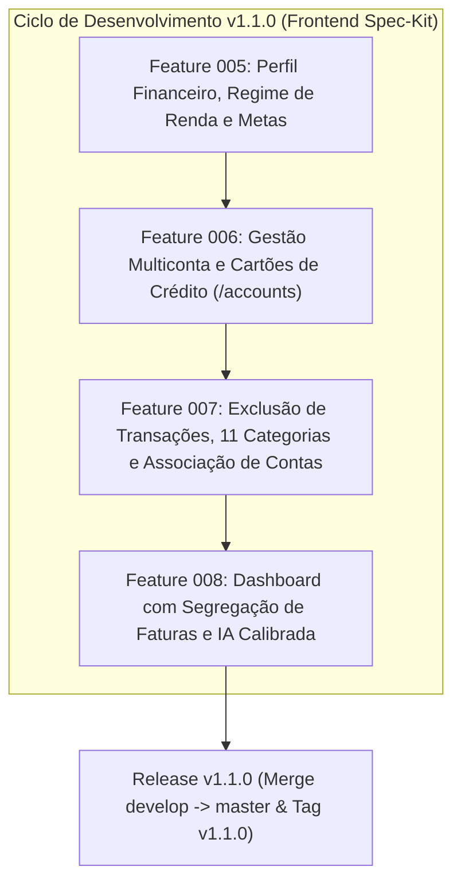

# 🗺️ Roadmap de Evolução — Frontend (v1.1.0+)

Este documento estabelece o planejamento estratégico, arquitetura de componentes e a esteira de desenvolvimento do **Frontend (`projeto-frontend-dashboard`)** para o ciclo **v1.1.0**, em total conformidade com a Constituição Técnica, os princípios de **Schema-Driven Development (SDD)** e os fluxos do **Spec-Kit**.

---

## 📌 Status Atual do Projeto

| Versão | Status | Branches / Tags | Cobertura de Testes |
|---|---|---|---|
| **v1.0.0** | ✅ Concluída em Produção | Tag `v1.0.0` / Branch `master` | 151 testes unitários/integração verdes |
| **v1.1.0** | ✅ Features 005 a 008 Concluídas | Branch `feature/008-dashboard-invoice-segregation-profile` | 239 testes unitários/integração verdes |

### Histórico de Features Entregues (v1.0.0)
- `specs/001-auth-shell-byok`: Autenticação JWT, Shell responsivo (Sidebar/Navbar), tema Dark/Light e modal BYOK Gemini.
- `specs/002-transactions-management`: Upload OFX/CSV, tabela paginada com 9 categorias iniciais, edição inline e classificação por IA.
- `specs/003-dashboard-metrics-analysis`: KPIs mensais, gráfico de rosca de categorias, diagnóstico do mês em cache e recomendações.
- `specs/004-virtual-financial-advisor`: Assistente virtual conversacional via streaming contínuo SSE com Google Gemini.

---

## 🎯 Visão Geral do Ciclo v1.1.0

O ciclo v1.1.0 conecta o frontend a todas as novas capacidades já implementadas e testadas no backend (Features 007 a 010 do backend), trazendo **Gestão Multicontas**, **Exclusão Atômica de Transações**, **11 Categorias Canônicas**, **Segregação Contábil de Faturas** e **Perfil Financeiro do Usuário com IA Calibrada**.



---

## 📋 Features Planejadas (Ciclo v1.1.0)

### 👤 Feature 005: Perfil Financeiro, Regime de Renda e Metas (`specs/005-financial-profile-onboarding`)
**Objetivo**: Permitir ao usuário personalizar seu contexto financeiro de forma 100% voluntária, fornecendo regime de renda, renda declarada, metas prioritárias e perfil de risco, que serão consumidos pelo Gemini para calibração das análises.

- **Contratos de API**:
  - `GET /api/user/profile`: Retorna dados cadastrais e o objeto `financialProfile`.
  - `PUT /api/user/profile`: Atualiza dados do perfil voluntário (invalida automaticamente cache de IA no backend).
- **Entregas de Interface & Componentes**:
  - Nova tela/seção `/settings/profile` (ou aba dedicada no shell de configurações).
  - Banner discreto no Dashboard convidando ao preenchimento do perfil (com opção de dispensar).
  - Seletor visual de **Regime de Renda**: `CLT`, `PJ_AUTONOMO`, `PUBLIC_SERVANT`, `ENTREPRENEUR`, `STUDENT`, `RETIRED`, `OTHER`.
  - Input de **Renda Mensal Declarada** com formatação de moeda brasileira (BRL) e validação de valores não negativos.
  - Seletor múltiplo em chips de **Metas Financeiras**: `RESERVA_EMERGENCIA`, `QUITAR_DIVIDAS`, `COMPRAR_IMOVEL`, `INVESTIR_LONGO_PRAZO`, `CONTROLE_GASTOS`.
  - Seletor de **Perfil de Risco**: `CONSERVATIVE`, `MODERATE`, `AGGRESSIVE`.
  - Invalidação reativa via TanStack Query (`userProfile`, `financialAnalysis`, `chatSession`).
- **Comandos Spec-Kit**:
  ```bash
  /speckit-specify Criar tela e componentes de perfil financeiro voluntário consumindo GET /api/user/profile e PUT /api/user/profile, com regime de renda, renda declarada em BRL, seleção múltipla de metas financeiras e perfil de risco, banner contextual no dashboard e invalidação reativa de cache.
  ```

---

### 🏦 Feature 006: Gestão Multiconta e Cartões de Crédito (`specs/006-accounts-management`)
**Objetivo**: Oferecer visão consolidada e detalhada de múltiplas contas e cartões, exibindo patrimônio líquido unificado e permitindo o gerenciamento completo de cada instituição.

- **Contratos de API**:
  - `GET /api/accounts`: Listagem de contas com saldo individual e `netWorth` consolidado.
  - `POST /api/accounts`: Criação de conta manual (`name`, `type`, `initialBalance`, `institution`, `color`).
  - `PATCH /api/accounts/:id`: Edição de metadados da conta.
  - `DELETE /api/accounts/:id?cascade=true|false`: Exclusão segura com política de cascata.
- **Entregas de Interface & Componentes**:
  - Nova rota e página `/accounts` com navegação na Sidebar/Navbar.
  - Card de Destaque: **Patrimônio Líquido Total** (`netWorth`) com indicador visual de saldo positivo/negativo.
  - Grid de Cards de Contas agrupadas ou categorizadas por tipo:
    - `CHECKING` (Conta Corrente)
    - `CREDIT_CARD` (Cartão de Crédito)
    - `INVESTMENT` (Investimentos)
    - `CASH` (Dinheiro em Espécie)
    - `OTHER` (Outras Contas)
  - Modal "Nova Conta" / "Editar Conta" com:
    - Input de nome/apelido.
    - Seletor de tipo de conta.
    - Input de saldo inicial em BRL.
    - Seletor de cor hexadecimal com paleta pré-definida e color picker.
  - Diálogo de Confirmação de Exclusão alertando sobre transações vinculadas e checkbox para exclusão em cascata (`cascade=true`).
- **Comandos Spec-Kit**:
  ```bash
  /speckit-specify Criar módulo de gestão de contas e cartões em /accounts consumindo GET /api/accounts, POST /api/accounts, PATCH /api/accounts/:id e DELETE /api/accounts/:id, exibindo cards de saldo por tipo, card de patrimônio líquido consolidado, modal de criação/edição com seletor de cor e diálogo de exclusão segura com suporte a cascade.
  ```

---

### 🏷️ Feature 007: Exclusão de Transações, 11 Categorias Canônicas e Associação de Contas (`specs/007-transactions-extended-deletion-categories`)
**Objetivo**: Estender a tela de transações com suporte às 11 categorias canônicas oficiais, vincular lançamentos a contas e permitir a exclusão pontual de transações duplicadas ou incorretas.

- **Contratos de API**:
  - `DELETE /api/transactions/:id`: Exclusão pontual atômica de transação.
  - `PATCH /api/transactions/:id`: Suporte à alteração de `accountId`, além de `category` e `cleanDescription`.
  - `POST /api/transactions/upload?accountId=<id>`: Upload de OFX/CSV com vinculação opcional à conta selecionada.
  - `GET /api/transactions?accountId=<id>`: Filtro por conta bancária.
- **Entregas de Interface & Componentes**:
  - Atualização do Enum e Badges para as **11 Categorias Canônicas**:
    - Adição de `Pagamento de Fatura` (#64748B) e `Investimentos` (#06B6D4).
  - Ação de **Excluir Transação** na tabela com diálogo de confirmação (alert dialog) e toast de feedback.
  - Dropdown de Conta no modal de upload de arquivos (permitindo associar o arquivo importado a uma conta específica).
  - Coluna ou Badge de Conta na tabela de transações.
  - Filtro por Conta no cabeçalho da tabela de transações.
  - Atualização do modal de edição inline para permitir transferir a transação para outra conta.
- **Comandos Spec-Kit**:
  ```bash
  /speckit-specify Estender módulo de transações adicionando suporte às 11 categorias canônicas (incluindo Pagamento de Fatura e Investimentos), ação de exclusão via DELETE /api/transactions/:id com diálogo de confirmação, seletor de conta no upload de extratos e filtro por conta na listagem.
  ```

---

### 📊 Feature 008: Dashboard com Segregação de Faturas e Diagnóstico IA Calibrado (`specs/008-dashboard-invoice-segregation-profile`)
**Objetivo**: Aprimorar o dashboard principal com segregação inteligente de faturas de cartão de crédito e integração do parecer calibrado do Gemini de acordo com o regime de renda e metas do usuário.

- **Contratos de API**:
  - `GET /api/analysis/:month`: Consumo do campo `invoiceSettlements` e parecer calibrado.
- **Entregas de Interface & Componentes**:
  - Ajuste no card de Despesas Primárias (Consumo Real) vs Quitação de Faturas:
    - Novo Card de KPI: **Quitação de Faturas** (`invoiceSettlements`), informando o valor de liquidação de cartão de crédito sem duplicar nas despesas primárias.
    - Saldo Líquido atualizado: `totalIncome - totalExpenses - invoiceSettlements`.
  - Ajuste no Gráfico de Rosca de Categorias: faturas de cartão são discriminadas corretamente sem distorcer o percentual de consumo.
  - Card de Diagnóstico do Mês com IA Calibrada:
    - Alerta de meta de **Reserva de Emergência sob medida** (exibe recomendação de 3 a 6 meses de gastos para CLT vs 6 a 12 meses para PJ/Autônomo).
    - Destaque das recomendações alinhadas às metas declaradas pelo usuário (ex: desendividamento prioritário quando a meta for `QUITAR_DIVIDAS`).
- **Comandos Spec-Kit**:
  ```bash
  /speckit-specify Atualizar o dashboard financeiro para exibir card segregado de Quitação de Faturas (invoiceSettlements), recalcular saldo líquido sem duplicidade contábil, ajustar gráfico de distribuição e exibir diagnóstico da IA com metas de reserva calibradas pelo perfil de renda do usuário.
  ```

---

## 🛠️ Regras de Governança e Qualidade (Constituição Técnica)

Para todas as features do roadmap, as seguintes regras são inegociáveis:
1. **TypeScript Estrito & Zero `any`**: Tipagens dinâmicas devem ser resolvidas com Zod ou interfaces canônicas de `src/types/api.ts`.
2. **TanStack Query Reativo**: Mutações (`POST`, `PATCH`, `DELETE`) devem invalidar as queries relacionadas (`invalidateQueries`), garantindo consistência sem recarregamento de página.
3. **Portais para Modais**: Todos os modais (`Dialog`, `AlertDialog`) devem renderizar via `createPortal(..., document.body)` para evitar bugs de contêineres CSS (`backdrop-blur`).
4. **Resiliência de Rede**: Interceptar falhas de conexão no chat SSE e requisições HTTP, fornecendo mensagens amigáveis em português e opção de repetição.
5. **Cobertura de Testes**: Cada feature deve incluir testes de unidade e integração (Vitest + Testing Library) com 100% de aprovação antes do merge.

---

## 📅 Sequência Recomendada de Execução

1. **Protocolar ROADMAP.md e commit no branch `develop`**.
2. **Iniciar Feature 005 (`specs/005-financial-profile-onboarding`)**:
   - `git checkout -b feature/005-financial-profile-onboarding develop`
   - `/speckit-specify` $\rightarrow$ `/speckit-plan` $\rightarrow$ `/speckit-tasks` $\rightarrow$ `/speckit-implement` $\rightarrow$ `/speckit-converge`
3. **Executar Feature 006 (`specs/006-accounts-management`)**.
4. **Executar Feature 007 (`specs/007-transactions-extended-deletion-categories`)**.
5. **Executar Feature 008 (`specs/008-dashboard-invoice-segregation-profile`)**.
6. **Release v1.1.0**: Bateria de testes finais, merge em `develop` $\rightarrow$ `master` e tag `v1.1.0`.
