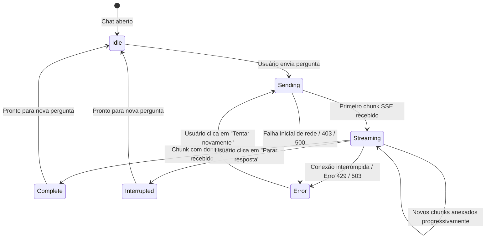

# Data Model: Painel Conversacional de Consultoria Financeira Virtual com Streaming SSE

**Feature**: `004-virtual-financial-advisor`  
**Date**: 2026-10-19  
**Status**: Ready  

---

## 1. Entidades de Domínio

### 1.1 `ChatMessage`
Representa uma mensagem atômica dentro do histórico do diálogo entre a pessoa usuária e o consultor financeiro.

| Campo | Tipo | Obrigatório | Descrição |
|---|---|:---:|---|
| `id` | `string` (UUID v4) | Sim | Identificador único local da mensagem. |
| `role` | `'user' \| 'model'` | Sim | Papel do autor da mensagem (usuário ou assistente virtual). |
| `content` | `string` | Sim | Conteúdo textual da mensagem (suporta formatação Markdown). |
| `timestamp` | `string` (ISO 8601 UTC) | Sim | Carimbo de data/hora de envio ou recepção. |
| `status` | `'sending' \| 'streaming' \| 'complete' \| 'interrupted' \| 'error'` | Sim | Estado do ciclo de vida da mensagem. |
| `error` | `string` | Não | Mensagem de erro descritiva em caso de falha de conexão ou HTTP 429/503. |

### 1.2 `ChatSession`
Representa o contexto de conversação mantido no navegador (`sessionStorage`).

| Campo | Tipo | Obrigatório | Descrição |
|---|---|:---:|---|
| `sessionId` | `string` (UUID v4) | Sim | Identificador persistente da conversa transmitido ao backend. |
| `messages` | `ChatMessage[]` | Sim | Coleção cronologicamente ordenada de mensagens. |
| `isStreaming` | `boolean` | Sim | Flag indicando se há uma geração de resposta em andamento. |
| `currentStreamingText` | `string` | Sim | Acumulador temporário dos chunks durante a transmissão. |
| `createdAt` | `string` (ISO 8601) | Sim | Data de criação da sessão atual. |
| `updatedAt` | `string` (ISO 8601) | Sim | Data da última interação registrada na sessão. |

### 1.3 `QuickSuggestionChip`
Representa uma sugestão contextual de pergunta rápida exibida no estado vazio do chat.

| Campo | Tipo | Obrigatório | Descrição |
|---|---|:---:|---|
| `id` | `string` | Sim | Identificador único do atalho (ex: `chip-top-expense`). |
| `label` | `string` | Sim | Título curto de identificação do tema (ex: "Moradia", "Poupança"). |
| `prompt` | `string` | Sim | Pergunta completa a ser enviada ao assistente ao clicar. |
| `category` | `string` | Não | Categoria financeira associada, se aplicável. |
| `iconName` | `string` | Não | Nome do ícone visual correspondente (Lucide). |

### 1.4 `ChatStreamChunk`
Contrato canônico do pacote SSE recebido em cada linha `data: ...` da resposta do backend.

| Campo | Tipo | Obrigatório | Descrição |
|---|---|:---:|---|
| `text` | `string` | Não | Fragmento incremental de texto gerado pelo modelo. |
| `done` | `boolean` | Não | Sinalizador indicando o término da geração da resposta. |
| `sessionId` | `string` | Não | Identificador de sessão confirmado pelo servidor. |
| `error` | `string` | Não | Descrição de falha caso ocorra erro no backend ou upstream. |
| `code` | `string` | Não | Código de erro canônico (ex: `RATE_LIMIT_EXCEEDED`, `UPSTREAM_DEMAND`). |
| `statusCode` | `number` | Não | Código de status HTTP (ex: 403, 429, 503). |

---

## 2. Máquina de Estados da Mensagem do Assistente

---

## 3. Regras de Integridade e Validação

1. **Mensagens Vazias**: É terminantemente proibido o envio de mensagens vazias ou compostas unicamente por espaços em branco ou quebras de linha (`message.trim().length === 0`).
2. **Concorrência de Envio**: Enquanto `isStreaming === true`, o campo de texto e o botão de envio permanecem bloqueados, habilitando exclusivamente o botão "Parar resposta".
3. **Imutabilidade Histórica**: Mensagens anteriores (`status === 'complete' \| 'interrupted'`) não são alteradas durante o streaming de uma nova mensagem.
4. **Isolamento de Chave de IA**: Usuários com `hasAiKey === false` não transitam para o estado `Sending`, sendo mantidos no estado explicativo de configuração da chave BYOK.
5. **Sanitização de Markdown**: O conteúdo retornado pelo modelo é interpretado com suporte seguro a formatação rica (negrito, listas, tabelas) sem execução arbitrária de scripts.
