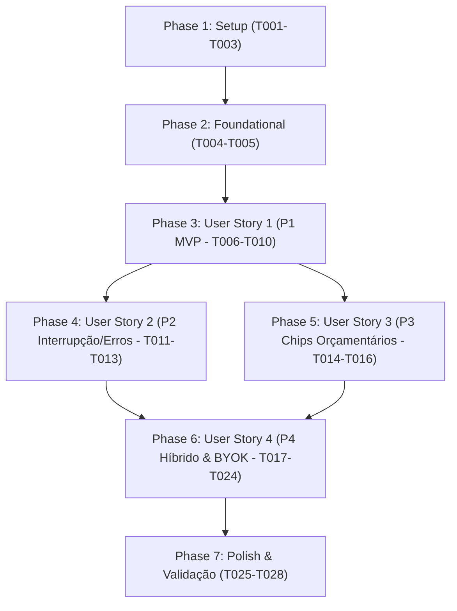

# Tasks: Painel Conversacional de Consultoria Financeira Virtual com Streaming SSE em Tempo Real

**Branch**: `004-virtual-financial-advisor` | **Date**: 2026-10-19 | **Spec**: [spec.md](./spec.md) | **Plan**: [plan.md](./plan.md)

Este documento estabelece o plano detalhado e sequencial de tarefas atômicas para implementação do Consultor Financeiro Virtual com Streaming SSE, organizado estritamente por fases e histórias de usuário (User Stories) independentes e testáveis.

---

## Phase 1: Setup (Shared Infrastructure)

**Purpose**: Criação da estrutura de diretórios e utilitários puros de processamento de fluxo SSE

- [ ] T001 Criar estrutura de diretórios para a feature em `components/chat/`
- [ ] T002 Implementar decodificador e parser de eventos SSE em `lib/chat-stream-parser.ts` decodificando buffers UTF-8, agrupando linhas fragmentadas e processando eventos `data: {JSON}\n\n`
- [ ] T003 [P] Criar testes unitários para o decodificador SSE em `lib/chat-stream-parser.test.ts` cobrindo pacotes parciais, sinalizador `done: true` e payloads de erro

---

## Phase 2: Foundational (Blocking Prerequisites)

**Purpose**: Hook customizado central de streaming com ReadableStream, AbortController e gestão de estado

**⚠️ CRITICAL**: Nenhuma User Story pode ser iniciada antes da conclusão e validação desta fase foundational.

- [ ] T004 Implementar custom hook `useChatStream` em `hooks/use-chat-stream.ts` gerenciando o consumo de `POST /api/chat/stream` com `fetch`, `ReadableStream`, estados de ciclo de vida (`idle`, `sending`, `streaming`, `complete`, `interrupted`, `error`), `AbortController` e emissão de mensagens
- [ ] T005 [P] Criar testes automatizados para `useChatStream` em `hooks/use-chat-stream.test.tsx` simulando respostas em stream, interrupção voluntária, persistência temporária e tratamento de códigos de status 403, 429 e 503

**Checkpoint**: Base foundational pronta — a implementação das User Stories pode iniciar sequencialmente ou em paralelo.

---

## Phase 3: User Story 1 - Diálogo Conversacional com Streaming em Tempo Real e Digitação Progressiva (Priority: P1) 🎯 MVP

**Goal**: Permitir à pessoa usuária enviar dúvidas em linguagem natural e visualizar a resposta do consultor sendo gerada progressivamente em tempo real via SSE com auto-scroll inteligente e renderização rica de Markdown.

**Independent Test**: Acessar a tela ou painel de chat, digitar uma dúvida financeira e validar o envio, o aparecimento imediato da mensagem do usuário e a digitação contínua token a token da resposta do assistente com rolagem suave automática.

### Tests for User Story 1 ⚠️

- [ ] T006 [P] [US1] Criar testes de componente para bolha de mensagem e lista rolável em `components/chat/chat-message-list.test.tsx` cobrindo papéis `user` e `model`, renderização de Markdown e auto-scroll

### Implementation for User Story 1

- [ ] T007 [P] [US1] Implementar componente de bolha de mensagem individual `ChatMessageItem` em `components/chat/chat-message-item.tsx` com estilização diferenciada para usuário/assistente, carimbo de horário, cursor pulsante de digitação e renderização de Markdown sanitizado
- [ ] T008 [US1] Implementar contêiner rolável `ChatMessageList` em `components/chat/chat-message-list.tsx` com rolagem automática suave ao receber novos tokens e detecção de rolagem manual para cima para pausar o auto-scroll
- [ ] T009 [US1] Implementar barra de entrada `ChatInput` em `components/chat/chat-input.tsx` com atalho Enter (sem Shift) para envio, bloqueio de mensagens vazias e botão de envio com ícone
- [ ] T010 [US1] Implementar contêiner orquestrador `ChatPanel` em `components/chat/chat-panel.tsx` conectando `useChatStream`, `ChatMessageList` e `ChatInput`

**Checkpoint**: User Story 1 (MVP) completamente funcional e testável de forma autônoma.

---

## Phase 4: User Story 2 - Controle de Interrupção de Geração e Resiliência de Conexão (Priority: P2)

**Goal**: Permitir interromper a geração da resposta a qualquer instante via botão "Parar resposta" (congelando o texto recebido) e apresentar alertas contextuais amigáveis para erros 429/503 com botão "Tentar novamente" embutido na bolha.

**Independent Test**: Iniciar uma pergunta longa e clicar em "Parar resposta" durante o streaming comprovando o encerramento imediato (< 100ms) e a retenção do texto parcial; simular erro 429/503 e comprovar a aparição do botão "Tentar novamente" reexecutando a pergunta com 1 clique.

### Tests for User Story 2 ⚠️

- [ ] T011 [P] [US2] Criar testes automatizados para interrupção de stream e retry em `components/chat/chat-panel.test.tsx` cobrindo clique no botão "Parar resposta" e disparo de "Tentar novamente" em bolha com erro

### Implementation for User Story 2

- [ ] T012 [US2] Adicionar alternância de estado dinâmico no `ChatInput` em `components/chat/chat-input.tsx` para exibir botão de parada ("Parar resposta" com ícone quadrado/stop) durante `isStreaming === true` acoplado ao `stopStream()` do hook
- [ ] T013 [US2] Implementar alerta visual inline e botão "Tentar novamente" em `components/chat/chat-message-item.tsx` para mensagens com `status === 'error'`, permitindo reprocessar a última pergunta sem reescrever o texto

**Checkpoint**: User Stories 1 e 2 totalmente funcionais com controle total de cancelamento e tolerância a falhas.

---

## Phase 5: User Story 3 - Sugestões de Perguntas Rápidas Baseadas no Orçamento do Mês (Priority: P3)

**Goal**: Apresentar chips inteligentes de perguntas rápidas contextuais geradas a partir do orçamento do mês ativo (maior categoria de despesa, taxa de poupança, atipicidades) e fallback educativo, exibidos em destaque no estado vazio e recolhidos após o primeiro envio.

**Independent Test**: Abrir o chat em um mês com transações e conferir chips personalizados (ex: "Como reduzir gastos em Moradia?"); clicar em um chip e validar o disparo imediato da mensagem; abrir em mês sem transações e validar os chips educativos conceituais.

### Tests for User Story 3 ⚠️

- [ ] T014 [P] [US3] Criar testes de componente para os chips de perguntas rápidas em `components/chat/quick-suggestion-chips.test.tsx` cobrindo geração orçamentária contextual, fallback de educação financeira e disparo de evento de clique

### Implementation for User Story 3

- [ ] T015 [P] [US3] Implementar componente `QuickSuggestionChips` em `components/chat/quick-suggestion-chips.tsx` lendo métricas do cache TanStack Query `['analysis', currentMonth]`, montando atalhos de alto impacto orçamentário ou fallback de educação financeira
- [ ] T016 [US3] Integrar `QuickSuggestionChips` na área central do `ChatPanel` em `components/chat/chat-panel.tsx`, mantendo-os visíveis no estado vazio/inicial e recolhendo-os automaticamente após o primeiro envio

**Checkpoint**: User Stories 1, 2 e 3 funcionando de forma integrada e proativa.

---

## Phase 6: User Story 4 - Histórico de Mensagens, Continuidade de Sessão e Gate BYOK (Priority: P4)

**Goal**: Garantir persistência do diálogo no `sessionStorage`, botão "Nova consulta", modelo híbrido com gaveta lateral (`ChatDrawer`) global e tela cheia dedicada (`/chat`), além de bloqueio pedagógico BYOK quando `hasAiKey === false`.

**Independent Test**: Realizar trocas de mensagens, fechar e reabrir o drawer e atualizar a página comprovando que o histórico é restaurado do `sessionStorage`; clicar em "Nova consulta" e verificar a limpeza do chat com novo `sessionId`; acessar com conta sem chave e validar a exibição do bloqueio com abertura do modal de chave BYOK.

### Tests for User Story 4 ⚠️

- [ ] T017 [P] [US4] Criar testes de componente para o Drawer lateral e persistência em `components/chat/chat-drawer.test.tsx` cobrindo abertura/fechamento global, botão de tela cheia e restauração do histórico

### Implementation for User Story 4

- [ ] T018 [P] [US4] Implementar persistência de mensagens e `sessionId` em `sessionStorage` sob `@finai:chat_session` e função `clearChat()` com geração de novo UUID em `hooks/use-chat-stream.ts`
- [ ] T019 [P] [US4] Implementar contexto e provedor global `ChatDrawerContext` em `components/chat/chat-drawer-context.tsx` gerenciando o estado de visibilidade (`isOpen`, `openDrawer`, `closeDrawer`, `toggleDrawer`)
- [ ] T020 [US4] Implementar gaveta lateral deslizante `ChatDrawer` em `components/chat/chat-drawer.tsx` com cabeçalho, botão "Nova consulta", botão de expansão para `/chat` e botão de fechar
- [ ] T021 [P] [US4] Implementar botão flutuante de atalho rápido `ChatFloatingButton` em `components/chat/chat-floating-button.tsx` posicionado no canto inferior direito da interface
- [ ] T022 [US4] Implementar rota de tela cheia dedicada em `app/(dashboard)/chat/page.tsx` reutilizando o `ChatPanel` com cabeçalho de página e layout imersivo
- [ ] T023 [US4] Implementar estado educativo de chave ausente (Gate BYOK) em `components/chat/chat-panel.tsx` apresentando mensagem amigável e botão para acionar o modal `AiKeyModal` quando `user.hasAiKey === false`
- [ ] T024 [US4] Integrar `ChatDrawerProvider`, `ChatDrawer` e `ChatFloatingButton` no layout principal em `app/(dashboard)/layout.tsx` e atalho de abertura na barra de navegação em `components/layout/navbar.tsx`

**Checkpoint**: Todas as User Stories integradas e operacionais no modelo híbrido.

---

## Phase 7: Polish & Cross-Cutting Concerns

**Purpose**: Validação de qualidade estática, conformidade com a Constituição e garantia de zero quebras

- [ ] T025 [P] Executar checagem estrita de tipos TypeScript sem supressões via `pnpm typecheck`
- [ ] T026 [P] Executar validação de formatação e linting via `pnpm lint`
- [ ] T027 Executar suíte completa de testes automatizados com Vitest via `pnpm test` assegurando 100% de aprovação em todos os testes novos e pré-existentes
- [ ] T028 Executar homologação manual do fluxo ponta a ponta seguindo o roteiro de verificação em `specs/004-virtual-financial-advisor/quickstart.md`

---

## Dependencies & Execution Order

### Regras de Execução & Oportunidades de Paralelismo
- Tarefas marcadas com **[P]** atuam em arquivos independentes e podem ser desenvolvidas em paralelo sem conflitos de merge.
- As tarefas de testes unitários (**T003**, **T005**, **T006**, **T011**, **T014**, **T017**) devem ser executadas e validadas conjuntamente com a implementação correspondente.
- A fase Foundational (**T004-T005**) é pré-requisito mandatório para todas as User Stories.

---

## Implementation Strategy

### MVP First (User Story 1 Focus)
1. Completar Setup (T001-T003) e Foundational (T004-T005).
2. Implementar e validar a User Story 1 (T006-T010).
3. **Ponto de Parada MVP**: O chat básico com streaming SSE e auto-scroll estará 100% funcional.

### Entrega Incremental
1. Adicionar controle de interrupção e retry de erro (US2: T011-T013).
2. Adicionar os chips de atalho rápido orçamentários (US3: T014-T016).
3. Expandir para o modelo híbrido Drawer + `/chat`, persistência `sessionStorage` e Gate BYOK (US4: T017-T024).
4. Finalizar com auditoria completa de tipagem, testes e lint (Polish: T025-T028).
