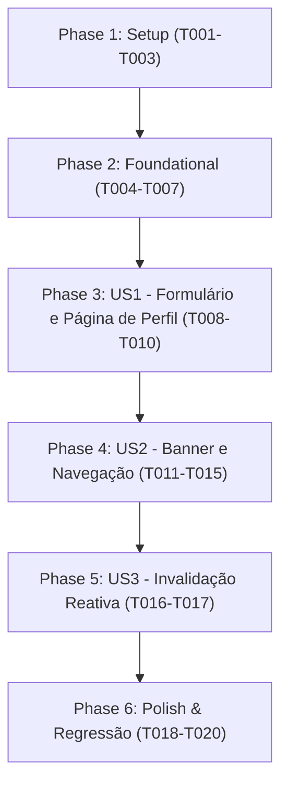

# Tasks: Perfil Financeiro, Regime de Renda e Metas do Usuário

**Input**: Design documents from `/specs/005-financial-profile-onboarding/`  
**Prerequisites**: `plan.md`, `spec.md`, `research.md`, `data-model.md`, `contracts/user-profile-contract.json`  
**Tests**: Testes automatizados obrigatórios conforme Princípio VII da Constituição Técnica (Vitest + Testing Library).  
**Organization**: Tarefas agrupadas por User Story para possibilitar implementação e testes independentes de cada fatia.

## Format: `[ID] [P?] [Story] Description`

- **[P]**: Tarefa executável em paralelo (arquivos distintos, sem dependência mútua)
- **[Story]**: User Story à qual a tarefa pertence (US1, US2, US3)
- Caminhos de arquivo exatos incluídos em cada tarefa

---

## Phase 1: Setup (Shared Infrastructure)

**Purpose**: Estruturas de dados, contratos canônicos e formatadores utilitários

- [x] T001 Estender tipos canônicos em `types/api.ts` com `INCOME_TYPES`, `IncomeType`, `INCOME_TYPE_LABELS`, `FINANCIAL_GOALS`, `FinancialGoal`, `FINANCIAL_GOAL_LABELS`, `RISK_PROFILES`, `RiskProfile`, `RISK_PROFILE_LABELS`, `FinancialProfile`, `UserProfileResponse` e `UpdateFinancialProfileDTO`.
- [x] T002 [P] Implementar schema Zod `updateFinancialProfileSchema` e tipos inferidos em `lib/validations/profile.ts`.
- [x] T003 [P] Implementar funções utilitárias `parseBrlToNumber` e `formatCurrency` em `lib/formatters.ts` para conversão progressiva de moeda BRL.

---

## Phase 2: Foundational (Blocking Prerequisites)

**Purpose**: Validações, testes unitários de base e hook TanStack Query

**⚠️ CRITICAL**: Nenhuma User Story visual deve começar antes de concluir esta fase.

- [x] T004 [P] Criar testes unitários em `lib/validations/profile.test.ts` cobrindo validação de enums, valores positivos de renda e campos opcionais.
- [x] T005 [P] Criar testes unitários em `lib/formatters.test.ts` validando parsing de strings BRL (`R$ 1.500,50` -> `1500.5`) e valores vazios.
- [x] T006 Implementar hook `useUserProfile` e mutation `useUpdateFinancialProfile` em `hooks/use-user-profile.ts` consumindo `GET /api/user/profile` e `PUT /api/user/profile` via `apiClient`.
- [x] T007 Criar testes automatizados para o hook em `hooks/use-user-profile.test.tsx` cobrindo carregamento, mutação com sucesso e tratamento de erros.

**Checkpoint**: Camada de dados e contratos pronta.

---

## Phase 3: User Story 1 - Visualizar e Preencher Perfil Financeiro (Priority: P1) 🎯 MVP

**Goal**: Permitir ao usuário autenticado visualizar seu perfil e salvar voluntariamente regime de renda, renda declarada, metas financeiras e tolerância a risco.

**Independent Test**: Acessar `/settings/profile`, preencher o formulário com dados válidos, salvar e verificar confirmação via toast e dados salvos no formulário.

### Tests for User Story 1 ⚠️
- [x] T008 [P] [US1] Criar testes de componente em `components/profile/financial-profile-form.test.tsx` (renderização inicial, seleção de regime, máscara de renda, seleção múltipla de metas, escolha de risco e disparo da submissão).

### Implementation for User Story 1
- [x] T009 [US1] Implementar componente `FinancialProfileForm` em `components/profile/financial-profile-form.tsx` com `react-hook-form`, resolver Zod, máscaras visuais, seleção de chips e estados de carregamento.
- [x] T010 [US1] Criar página protegida de perfil em `app/settings/profile/page.tsx` renderizando o `FinancialProfileForm` com cabeçalho descritivo.

**Checkpoint**: User Story 1 totalmente funcional e testável de forma independente.

---

## Phase 4: User Story 2 - Notificação Contextual e Acesso Ágil no Dashboard (Priority: P2)

**Goal**: Exibir banner de convite no Dashboard para usuários sem perfil com controle de dispensa em `sessionStorage`, e atalhos na Sidebar e Navbar.

**Independent Test**: Acessar Dashboard sem perfil e constatar o banner; dispensar o banner e verificar que permanece oculto na sessão; validar links na Navbar e Sidebar.

### Tests for User Story 2 ⚠️
- [x] T011 [P] [US2] Criar testes automatizados para o banner em `components/profile/profile-onboarding-banner.test.tsx` (exibição condicional, clique em Dispensar gravando no `sessionStorage`, clique em Configurar Perfil).

### Implementation for User Story 2
- [x] T012 [US2] Implementar componente `ProfileOnboardingBanner` em `components/profile/profile-onboarding-banner.tsx`.
- [x] T013 [US2] Integrar `ProfileOnboardingBanner` no topo do Dashboard em `app/(dashboard)/page.tsx`.
- [x] T014 [P] [US2] Atualizar a Sidebar em `components/layout/sidebar.tsx` adicionando item de menu fixo "Perfil Financeiro" apontando para `/settings/profile`.
- [x] T015 [P] [US2] Atualizar a Navbar em `components/layout/navbar.tsx` adicionando opção "Meu Perfil Financeiro" no dropdown de usuário.

**Checkpoint**: User Stories 1 e 2 funcionando de forma integrada e independente.

---

## Phase 5: User Story 3 - Sincronização e Atualização Automática das Análises (Priority: P3)

**Goal**: Assegurar invalidação reativa de cache no TanStack Query após mutação de perfil para sincronizar análises e IA.

**Independent Test**: Salvar alteração de perfil e validar que `invalidateQueries({ queryKey: ['financial-analysis'] })` foi disparado.

- [x] T016 [US3] Configurar invalidação das queries `['financial-analysis']` e `['user-profile']` no hook `hooks/use-user-profile.ts` em caso de sucesso da mutation.
- [x] T017 [US3] Adicionar asserção de invalidação no teste `hooks/use-user-profile.test.tsx`.

**Checkpoint**: Todas as user stories implementadas e com integridade de cache.

---

## Phase 6: Polish & Cross-Cutting Concerns

**Purpose**: Verificação global de qualidade e testes de regressão

- [x] T018 [P] Executar suite completa de testes automatizados com `npm test -- --run` garantindo 100% de aprovação.
- [x] T019 [P] Validar compilação TypeScript estrita (`npx tsc --noEmit`) garantindo zero erros de tipagem.
- [x] T020 Executar validação funcional de ponta a ponta seguindo o roteiro de `quickstart.md`.

---

## Dependencies & Execution Order

### Parallel Opportunities
- **Phase 1**: T002 e T003 podem ser executados em paralelo após T001.
- **Phase 2**: T004 e T005 podem ser executados em paralelo.
- **Phase 3**: T008 (testes) pode ser escrito antes da implementação de T009.
- **Phase 4**: T011, T014 e T015 podem ser executados em paralelo.
- **Phase 6**: T018 e T019 podem rodar em paralelo.

---

## Implementation Strategy: MVP First (User Story 1 Only)

1. Concluir Setup (T001-T003) + Foundational (T004-T007).
2. Concluir User Story 1 (T008-T010): formulário de perfil e página `/settings/profile` operacionais com testes unitários.
3. **Validar MVP**: testar tela de perfil e salvamento.
4. Concluir User Story 2 (T011-T015): banner no Dashboard e navegação.
5. Concluir User Story 3 (T016-T017): invalidação de cache reativo.
6. Executar Polish & regressão (T018-T020).
