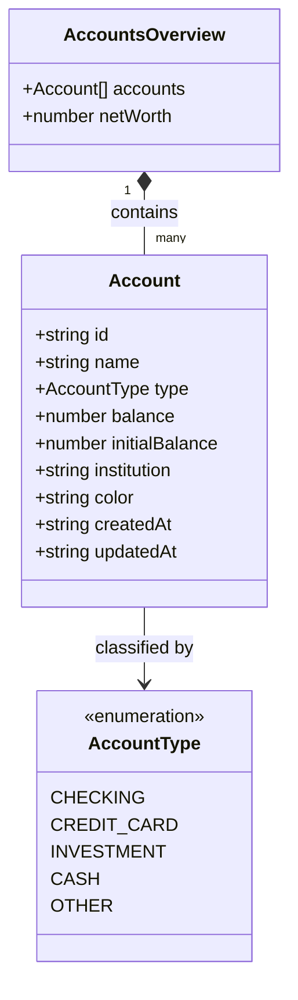

# Data Model & Validation Schemas: Gestão Multiconta e Cartões de Crédito

**Feature**: `specs/006-accounts-management`  
**Date**: 2026-10-19  

Este documento define os tipos TypeScript canônicos, contratos de dados e schemas de validação Zod para a gestão de contas e cartões no frontend.

---

## 1. Tipos Canônicos de Domínio (`types/api.ts`)

```typescript
// ==========================================
// TIPOS DE CONTA BANCÁRIA E PATRIMÔNIO
// ==========================================

export const ACCOUNT_TYPES = [
  'CHECKING',
  'CREDIT_CARD',
  'INVESTMENT',
  'CASH',
  'OTHER',
] as const;

export type AccountType = (typeof ACCOUNT_TYPES)[number];

export const ACCOUNT_TYPE_LABELS: Record<AccountType, string> = {
  CHECKING: 'Conta Corrente',
  CREDIT_CARD: 'Cartão de Crédito',
  INVESTMENT: 'Investimentos',
  CASH: 'Dinheiro em Espécie',
  OTHER: 'Outras Contas',
};

export const ACCOUNT_TYPE_ICONS: Record<AccountType, string> = {
  CHECKING: 'Landmark',
  CREDIT_CARD: 'CreditCard',
  INVESTMENT: 'TrendingUp',
  CASH: 'Banknote',
  OTHER: 'Wallet',
};

export interface Account {
  id: string;
  name: string;
  type: AccountType;
  balance: number;
  initialBalance: number;
  institution?: string;
  color: string;
  createdAt: string;
  updatedAt: string;
}

export interface AccountsOverview {
  accounts: Account[];
  netWorth: number;
}

export interface CreateAccountDTO {
  name: string;
  type: AccountType;
  initialBalance?: number;
  institution?: string;
  color?: string;
}

export interface UpdateAccountDTO {
  name?: string;
  type?: AccountType;
  initialBalance?: number;
  institution?: string;
  color?: string;
}

export interface DeleteAccountParams {
  id: string;
  cascade?: boolean;
}
```

---

## 2. Schemas de Validação Zod (`lib/validations/account.ts`)

```typescript
import { z } from 'zod';
import { ACCOUNT_TYPES } from '@/types/api';

export const HEX_COLOR_REGEX = /^#[0-9A-Fa-f]{6}$/;

export const createAccountSchema = z.object({
  name: z
    .string()
    .trim()
    .min(1, 'Nome da conta é obrigatório')
    .max(50, 'Nome deve ter no máximo 50 caracteres'),
  type: z.enum(ACCOUNT_TYPES, {
    errorMap: () => ({ message: 'Tipo de conta inválido' }),
  }),
  initialBalance: z.number().default(0),
  institution: z
    .string()
    .trim()
    .max(50, 'Instituição deve ter no máximo 50 caracteres')
    .optional(),
  color: z
    .string()
    .regex(HEX_COLOR_REGEX, 'Cor deve estar no formato hexadecimal (#RRGGBB)')
    .default('#2563EB'),
});

export type CreateAccountInput = z.infer<typeof createAccountSchema>;

export const updateAccountSchema = createAccountSchema.partial();
export type UpdateAccountInput = z.infer<typeof updateAccountSchema>;
```

---

## 3. Paleta de Cores Padrão

Para seleção rápida na interface:

| Cor Hexadecimal | Nome de Referência | Uso Recomendado |
|---|---|---|
| `#2563EB` | Azul Royal | Grandes bancos (Caixa, etc.) |
| `#8B5CF6` | Roxo Violeta | Fintechs / Nubank |
| `#F97316` | Laranja | Banco Inter, Itaú |
| `#10B981` | Verde Esmeralda | Dinheiro / Reserva / Safra |
| `#06B6D4` | Ciano | Corretoras / Investimentos (XP) |
| `#EF4444` | Vermelho | Santander, Bradesco |
| `#F59E0B` | Âmbar / Ouro | Banco do Brasil |
| `#64748B` | Grafite / Slate | Outras contas e reservas físicas |

---

## 4. Relação de Entidades e Diagrama de Estados


