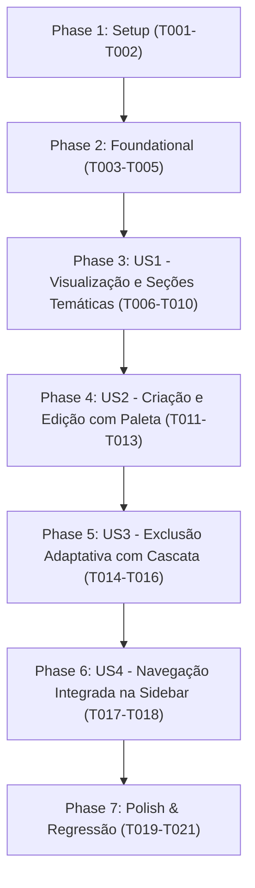

# Tasks: Gestão Multiconta e Cartões de Crédito

**Input**: Design documents from `/specs/006-accounts-management/`  
**Prerequisites**: `plan.md`, `spec.md`, `research.md`, `data-model.md`, `contracts/accounts-contract.json`  
**Tests**: Testes automatizados obrigatórios conforme Princípio VII da Constituição Técnica (Vitest + Testing Library).  
**Organization**: Tarefas agrupadas por User Story para possibilitar implementação e testes independentes de cada fatia.

## Format: `[ID] [P?] [Story] Description`

- **[P]**: Tarefa executável em paralelo (arquivos distintos, sem dependência mútua)
- **[Story]**: User Story à qual a tarefa pertence (US1, US2, US3, US4)
- Caminhos de arquivo exatos incluídos em cada tarefa

---

## Phase 1: Setup (Shared Infrastructure)

**Purpose**: Estruturas de dados, tipos canônicos e schemas Zod

- [ ] T001 Extender tipos canônicos em `src/types/api.ts` e `types/api.ts` com `ACCOUNT_TYPES`, `AccountType`, `ACCOUNT_TYPE_LABELS`, `ACCOUNT_TYPE_ICONS`, `Account`, `AccountsOverview`, `CreateAccountDTO`, `UpdateAccountDTO` e `DeleteAccountParams`.
- [ ] T002 [P] Implementar schemas Zod `createAccountSchema` e `updateAccountSchema` em `lib/validations/account.ts` com validações de nome (min 1, max 50), tipo enum canônico, saldo inicial numérico (default 0) e regex hexadecimal `^#[0-9A-Fa-f]{6}$` para cores.

---

## Phase 2: Foundational (Blocking Prerequisites)

**Purpose**: Validações, testes unitários de base e hook TanStack Query

**⚠️ CRITICAL**: Nenhuma User Story visual deve começar antes de concluir esta fase.

- [ ] T003 [P] Criar testes unitários para os schemas Zod em `lib/validations/account.test.ts` cobrindo validação de nome obrigatório, tipos válidos/inválidos, valores padrão de saldo inicial e validação de cor hexadecimal.
- [ ] T004 Implementar hook `useAccounts` e mutações `useCreateAccount`, `useUpdateAccount` e `useDeleteAccount` em `hooks/use-accounts.ts` consumindo `apiClient.get`, `apiClient.post`, `apiClient.patch` e `apiClient.delete` com invalidação reativa de `['accounts']`, `['transactions']` e `['financial-analysis']`.
- [ ] T005 [P] Criar testes automatizados do hook em `hooks/use-accounts.test.tsx` com Vitest cobrindo carregamento de contas, cálculo de netWorth, mutação de criação, mutação de edição e mutação de exclusão com suporte a parâmetro de cascata.

**Checkpoint**: Camada de dados e contratos pronta.

---

## Phase 3: User Story 1 - Visão Consolidada do Patrimônio Líquido e Listagem de Contas (Priority: P1) 🎯 MVP

**Goal**: Permitir ao usuário autenticado visualizar seu patrimônio líquido consolidado (`netWorth`) com indicador visual positivo/negativo e a listagem estruturada de contas em seções verticais temáticas com subtotais parciais por categoria.

**Independent Test**: Acessar `/accounts`, verificar a renderização do card de destaque de Patrimônio Líquido Total consolidado e os cards de contas agrupados nas seções temáticas (`Contas Correntes`, `Cartões de Crédito`, `Investimentos`, `Dinheiro em Espécie`, `Outras Contas`) exibindo subtotais corretos.

### Tests for User Story 1 ⚠️

- [ ] T006 [P] [US1] Criar testes de componente em `components/accounts/account-card.test.tsx` validando renderização de nome, instituição, tipo, saldo formatado em BRL e indicador visual de cor personalizada.
- [ ] T007 [P] [US1] Criar testes de componente em `components/accounts/account-section.test.tsx` validando renderização de título temático, ícone canônico, subtotal acumulado e grid de cards.

### Implementation for User Story 1

- [ ] T008 [US1] Implementar componente `AccountCard` em `components/accounts/account-card.tsx` com badge de tipo, formatação monetária em BRL, cor customizada e botões de ação para editar e excluir.
- [ ] T009 [US1] Implementar componente `AccountSection` em `components/accounts/account-section.tsx` agrupando cards por categoria com cálculo e exibição do subtotal parcial daquela classe de conta.
- [ ] T010 [US1] Criar página protegida `/accounts` em `app/(dashboard)/accounts/page.tsx` integrando o card consolidado de Patrimônio Líquido Total (`netWorth`) com indicador positivo/negativo, seções temáticas verticais, estado vazio (*empty state*) acolhedor e estados de carregamento.

**Checkpoint**: User Story 1 totalmente funcional e testável de forma independente.

---

## Phase 4: User Story 2 - Cadastro e Edição de Contas com Personalização Visual (Priority: P2)

**Goal**: Permitir ao usuário cadastrar novas contas ou editar contas existentes através de janela modal guiada com seleção de tipo, instituição, saldo inicial (editável) e paleta de cores.

**Independent Test**: Abrir modal "+ Nova Conta", preencher formulário válido com cor e saldo inicial, submeter e verificar surgimento da conta na seção correspondente com recálculo do patrimônio líquido; em seguida, clicar em "Editar" no card, alterar saldo inicial e salvar, validando atualização instantânea.

### Tests for User Story 2 ⚠️

- [ ] T011 [P] [US2] Criar testes automatizados da modal em `components/accounts/account-form-dialog.test.tsx` cobrindo abertura para criação, abertura para edição pré-preenchida, seleção de cores da paleta, máscara de saldo inicial e submissão com sucesso.

### Implementation for User Story 2

- [ ] T012 [US2] Implementar componente `AccountFormDialog` em `components/accounts/account-form-dialog.tsx` utilizando `createPortal`, formulário com `react-hook-form` e resolver Zod, seletor de tipo de conta, máscara BRL para `initialBalance` (editável), paleta de 8 cores pré-definidas e input hexadecimal livre.
- [ ] T013 [US2] Conectar `AccountFormDialog` na página `app/(dashboard)/accounts/page.tsx` e nos cards de conta para habilitar criação ("+ Nova Conta") e edição de registros existentes.

**Checkpoint**: User Stories 1 e 2 funcionando de forma integrada e independente.

---

## Phase 5: User Story 3 - Exclusão Segura de Contas com Política de Cascata (Priority: P3)

**Goal**: Permitir a exclusão segura de contas com diálogo de confirmação claro, checkbox para cascata de transações e comportamento adaptativo para não fechar a modal e destacar a opção de cascata em caso de rejeição por transações vinculadas.

**Independent Test**: Clicar em "Excluir" em uma conta com lançamentos e tentar confirmar sem cascata; validar que o diálogo permanece aberto exibindo alerta contextual e destacando o checkbox; marcar a opção de cascata, confirmar e verificar remoção da conta da lista e recálculo do patrimônio líquido.

### Tests for User Story 3 ⚠️

- [ ] T014 [P] [US3] Criar testes automatizados do diálogo de exclusão em `components/accounts/account-delete-dialog.test.tsx` cobrindo confirmação direta sem cascata, marcação de checkbox de cascata e tratamento adaptativo de erro mantendo o diálogo aberto com alerta visual ao receber rejeição do backend.

### Implementation for User Story 3

- [ ] T015 [US3] Implementar componente `AccountDeleteDialog` em `components/accounts/account-delete-dialog.tsx` utilizando `createPortal`, alerta destrutivo, checkbox de cascata (`cascade=true`) e interceptação de erro `ApiClientError` para manter a modal aberta destacando o checkbox de cascata.
- [ ] T016 [US3] Conectar `AccountDeleteDialog` nos botões de exclusão dos cards de conta na página `app/(dashboard)/accounts/page.tsx`.

**Checkpoint**: User Stories 1, 2 e 3 funcionando de forma integrada e com integridade contábil.

---

## Phase 6: User Story 4 - Navegação Integrada na Aplicação (Priority: P4)

**Goal**: Disponibilizar acesso ágil e intuitivo à página `/accounts` via barra lateral (Sidebar) e navegação responsiva.

**Independent Test**: Clicar no link "Contas e Cartões" na Sidebar e validar o redirecionamento para `/accounts` com destaque visual de rota ativa.

- [ ] T017 [P] [US4] Atualizar `components/layout/sidebar.tsx` adicionando item de menu fixo "Contas e Cartões" apontando para `/accounts` com ícone de carteira (`Wallet` ou `Landmark`) e highlight de rota ativa.
- [ ] T018 [P] [US4] Criar testes unitários para navegação em `components/layout/sidebar.test.tsx` garantindo renderização do link `/accounts` e destaque de rota ativa.

**Checkpoint**: Todas as user stories integradas e navegáveis na aplicação.

---

## Phase 7: Polish & Cross-Cutting Concerns

**Purpose**: Verificação global de qualidade e testes de regressão

- [ ] T019 [P] Executar suite completa de testes automatizados com `npm test -- --run` garantindo 100% de aprovação e zero quebras de funcionalidades anteriores.
- [ ] T020 [P] Validar compilação TypeScript estrita (`npx tsc --noEmit`) assegurando zero erros de tipagem e estrita conformidade com a Constituição.
- [ ] T021 Executar validação funcional de ponta a ponta seguindo o roteiro de `quickstart.md`.

---

## Dependencies & Execution Order

### Parallel Opportunities
- **Phase 1**: T002 pode ser executado em paralelo após T001.
- **Phase 2**: T003 e T005 podem ser desenvolvidos em paralelo após T004.
- **Phase 3**: T006 e T007 (testes de componentes) podem ser escritos em paralelo antes de T008 e T009.
- **Phase 4**: T011 (testes) pode ser escrito antes da implementação de T012.
- **Phase 5**: T014 (testes de diálogo) pode rodar em paralelo.
- **Phase 6**: T017 e T018 podem ser executados em paralelo.
- **Phase 7**: T019 e T020 podem rodar em paralelo.

---

## Implementation Strategy: MVP First (User Story 1 Only)

1. Concluir Setup (T001-T002) + Foundational (T003-T005).
2. Concluir User Story 1 (T006-T010): página `/accounts` com card de patrimônio líquido e seções temáticas verticais com subtotais acumulados.
3. **Validar MVP**: testar página de contas e renderização correta de saldos e seções.
4. Concluir User Story 2 (T011-T013): modal de criação e edição com seletor de cores e máscara BRL.
5. Concluir User Story 3 (T014-T016): diálogo adaptativo de exclusão com política de cascata.
6. Concluir User Story 4 (T017-T018): atalho fixo de navegação na Sidebar.
7. Executar Polish & regressão (T019-T021).
